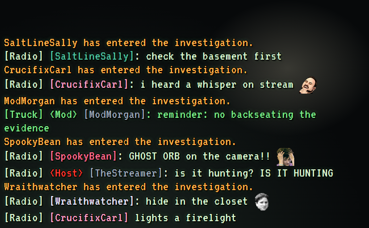

# Twitch Chat - Phasmophobia Radio Overlay

A single-file OBS Browser Source that shows your live Twitch chat as Phasmophobia-style radio chatter. Sister project of the WoW Guild Chat overlay: same engine, no install, no libraries, no Twitch login.

## The theme

- **Walkie-talkie lines:** `[Radio] [Name]: message` in pale CRT green-white. Moderators talk from the `[Truck] <Mod>` (the one watching the cameras) in monitor green.
- **Broadcaster:** `<Host>` tag in REC red.
- **Name colors are ghost types:** each chatter is hashed to one of the 24 ghost types' colors. Chatters pick their own with `!color Banshee`, `!color the twins` (or `twins`, `mimic`), `!color #ff8800`, or `!color reset`.
- **System lines** in EMF amber: `Name has entered the investigation.` on first message, `Name has signed a contract.` on a sub/gift sub.
- **Flicker:** lines flicker in and out like the lights during a hunt, instead of a plain fade.
- **Font:** VT323 (Google Fonts), a CRT terminal face like the truck's monitors. Falls back to Consolas/Courier if offline.

Everything else matches the WoW overlay: anonymous connection with reconnect, emotes, `/me`, mod deletions/timeouts/bans remove lines, ignored bots, HTML-safe text.

## Setup

1. Put `phasmochat.html` and `config.example.js` in a folder, copy `config.example.js` to `config.js` and set `channel`.
2. In OBS add a **Browser** source, tick **Local file**, choose `phasmochat.html`, size `700` x `450`, clear **Custom CSS**.
3. Preview without live chat: untick Local file and use `file:///C:/path/to/phasmochat.html?test=1`. `?channel=name` overrides the channel.

## Configuration

Edit `config.js`; see the comments in `config.example.js`. `colors` and `colors.ghosts` merge, so you can override a single entry. `ignoredUsers` replaces the whole list. After editing, refresh the Browser Source in OBS.
